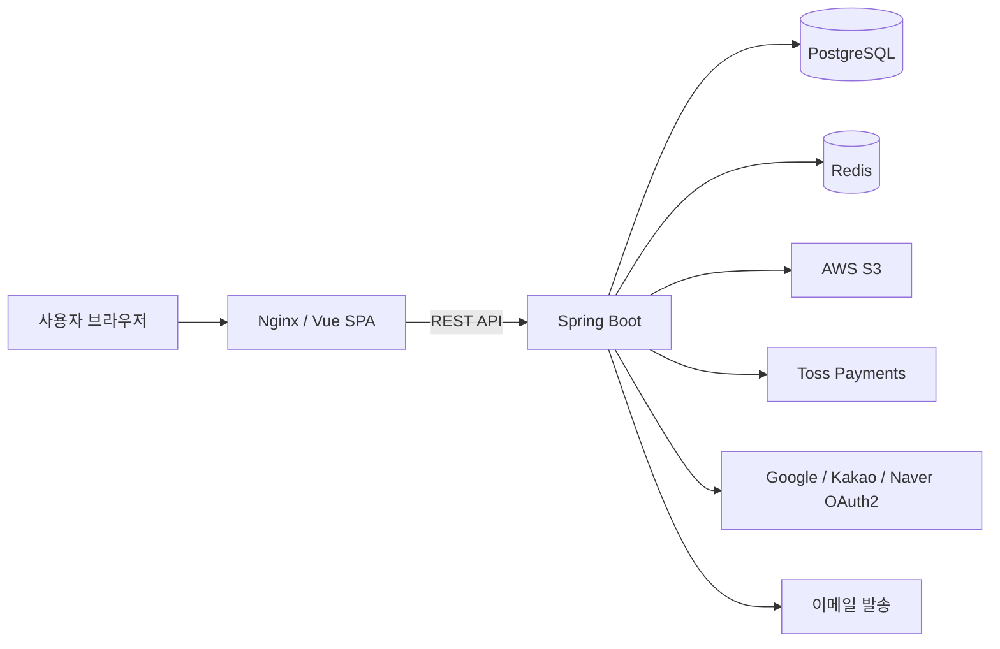
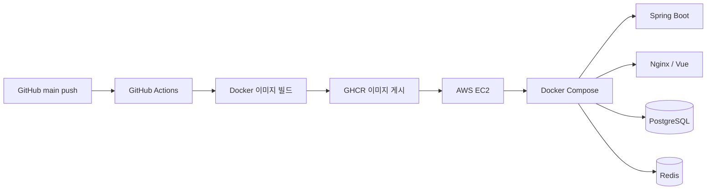

# COTW — 후원 프로젝트 플랫폼

> 게시글을 통해 후원 프로젝트를 소개하고, 사용자가 후원에 참여할 수 있도록 지원하는 웹 서비스

COTW는 프로젝트 게시글, 회원 인증, 후원 결제 및 후원 현황 집계 기능을 제공하는 웹 애플리케이션입니다. 팀 프로젝트로 핵심 서비스를 개발한 뒤, 개인적으로 배포 환경을 구성하고 실제 서비스 환경에 맞게 연동 문제를 수정했습니다.

이 README는 두 경험을 구분해 **책임(무엇을 맡았는가) · 판단(왜 그렇게 접근했는가) · 성과(무엇을 만들거나 개선했는가)** 중심으로 정리했습니다.

---

## 1. 프로젝트 개요

| 항목 | 내용 |
|---|---|
| 프로젝트 | COTW |
| 서비스 | 후원 프로젝트 소개 및 결제 플랫폼 |
| 진행 형태 | 팀 프로젝트 개발 → 개인 배포 및 운영 환경 구성 |
| 팀 프로젝트 역할 | 부팀장, 회원·인증 도메인 담당 |
| 개인 작업 | 배포 환경 구성, CI/CD 파이프라인 설정, 배포 환경 연동 오류 수정 |
| 주요 기술 | Java 21, Spring Boot 3.4.7, Vue 3, PostgreSQL, Redis |
| 배포 기술 | Docker, Docker Compose, Nginx, GitHub Actions, GHCR, AWS EC2 |

---

# 2. 팀 프로젝트 — 서비스 핵심 기능 개발

팀 프로젝트에서는 부팀장으로 참여해 회원·인증 도메인을 중심으로 기능을 개발했습니다. 서비스의 가입과 로그인부터 인증 상태의 유지 및 종료까지 사용자 인증 흐름을 구현하는 데 집중했습니다.

## 2-1. 회원 및 인증 기능

### 책임
- 이메일 기반 회원가입 및 이메일 인증 기능 구현
- 이메일·비밀번호 로그인 기능 구현
- Google, Kakao, Naver OAuth2 로그인 연동 작업
- Access Token과 Refresh Token을 활용한 인증 흐름 구현
- 로그아웃, 토큰 재발급, 비밀번호 변경, 회원 탈퇴 및 계정 복구 기능 개발
- 회원 상태와 토큰 버전을 고려한 인증 처리

### 판단
회원 인증은 사용자가 서비스를 이용하기 위한 진입점이며, 로그인 이후에도 인증 상태를 안전하게 유지하고 종료할 수 있어야 한다고 판단했습니다.

Access Token과 Refresh Token의 역할을 분리해 Access Token은 API 요청 인증에 사용하고, Refresh Token은 Access Token 재발급에 사용하도록 구성했습니다. 또한 Refresh Token을 서버 측에서 관리해 로그아웃이나 계정 상태 변경 시 기존 토큰을 폐기할 수 있도록 했습니다.

이메일 인증에는 Redis TTL을 적용해 인증코드의 유효기간을 관리하고, 인증 목적에 따라 코드를 구분해 회원가입 및 계정 관련 절차에 활용했습니다.

### 성과
- 일반 회원가입과 소셜 로그인을 함께 지원하는 회원 인증 흐름 구성
- Access Token 만료 이후 Refresh Token을 이용한 재발급 구조 구현
- 로그아웃 및 계정 상태 변경 시 Refresh Token을 폐기할 수 있는 관리 흐름 마련
- 이메일 인증코드의 만료 및 요청 제한을 서버 측에서 관리

## 2-2. 인증 관련 조회 성능 개선

### 책임
로그인 과정에서 발생하는 인증 관련 조회 시간을 줄이기 위해 기존 조회 흐름을 살펴보고 개선 작업을 진행했습니다.

### 판단
인증 과정에서 반복적으로 조회하는 데이터에 대한 접근 비용을 줄이기 위해 Redis를 활용했습니다. 영속 데이터는 RDBMS에서 관리하고, 빠른 조회와 만료 관리가 필요한 인증 데이터에는 Redis를 사용하는 방향으로 접근했습니다.

### 성과
로컬 환경에서 약 5~10회 테스트한 평균 응답 시간을 기준으로 로그인 응답 시간이 약 **2,000ms에서 800ms 수준으로 감소**했습니다.

- 측정 기준: 로컬 환경에서 반복 요청한 평균 응답 시간
- 개선 폭: 약 60% 감소
- 한계: 표본 수가 적어 운영 환경의 성능을 대표하는 수치로 볼 수 없음

---

# 3. 개인 배포 — 기존 서비스를 실제 환경에 배포

팀 프로젝트에서 개발한 서비스의 핵심 비즈니스 로직을 전면적으로 다시 작성하기보다는, 기존 코드를 배포 환경에서 실행할 수 있도록 구성하고 환경 차이로 발생하는 연결 및 실행 문제를 수정했습니다.

개인 배포의 핵심은 신규 기능 개발보다 **개발 환경에서 동작하던 프론트엔드와 백엔드, 데이터 저장소를 실제 서버 환경에 맞게 구성하고 배포 흐름을 만드는 것**이었습니다.

## 3-1. Docker 기반 배포 환경 구성

### 책임
- 프론트엔드와 백엔드의 Dockerfile 구성
- PostgreSQL, Redis, Spring Boot, Nginx를 Docker Compose로 구성
- 개발 환경과 운영 환경의 설정 분리
- 운영 환경에서 필요한 환경변수 및 서비스 연결 설정

### 판단
개발 환경과 서버 환경의 차이로 인해 실행 방식이나 설정이 달라지는 문제를 줄이기 위해 애플리케이션을 컨테이너 단위로 구성했습니다.

백엔드는 Gradle 빌드 단계와 실행 단계를 분리한 멀티 스테이지 Dockerfile을 사용하고, 프론트엔드는 Vue 빌드 결과물을 Nginx에서 제공하도록 구성했습니다. 데이터베이스와 Redis는 별도 컨테이너로 분리해 서비스 간 연결을 Docker 네트워크에서 관리했습니다.

### 성과
- 프론트엔드와 백엔드의 컨테이너 실행 환경 구성
- PostgreSQL과 Redis를 포함한 서비스 실행 구조 마련
- 운영 환경 설정을 별도 Compose 파일과 환경변수로 분리
- 애플리케이션 실행 및 데이터 저장소 연결을 컨테이너 단위로 관리

## 3-2. GitHub Actions와 GHCR를 이용한 이미지 빌드·배포 흐름 구성

### 책임
- GitHub Actions 워크플로우 작성
- 소스 변경 시 프론트엔드·백엔드 Docker 이미지 빌드
- GitHub Container Registry(GHCR)에 이미지 게시
- AWS EC2에서 배포 이미지를 가져올 수 있도록 SSH 기반 작업 구성

### 판단
서버에서 매번 소스 코드를 직접 빌드하는 방식 대신, GitHub Actions에서 이미지를 빌드하고 GHCR에 게시하는 흐름을 선택했습니다. 이를 통해 이미지 생성 과정과 서버 실행 환경을 분리하고, 배포 서버에서는 레지스트리에 게시된 이미지를 사용하도록 구성했습니다.

또한 EC2 환경의 아키텍처에 맞춰 ARM64 이미지 빌드를 적용했습니다.

### 성과
- GitHub main 브랜치 변경을 기준으로 이미지 빌드·게시 자동화
- 프론트엔드와 백엔드 이미지를 GHCR에 분리해 게시
- 커밋 SHA와 latest 태그를 이용한 이미지 버전 식별
- EC2에서 SSH를 통해 레지스트리 이미지를 가져오는 배포 작업 구성

## 3-3. 배포 환경의 프론트엔드·백엔드 연동 문제 수정

### 책임
배포 과정에서 로컬 개발 환경과 실제 도메인·서버 구성의 차이로 발생하는 요청 및 인증 문제를 확인하고 수정했습니다.

### 판단
로컬 환경에서는 개발 서버 프록시나 상대 경로를 통해 정상 동작하던 요청도, 프론트엔드와 백엔드가 분리된 배포 환경에서는 API 주소, CORS, 쿠키 전달 방식이 달라질 수 있다고 판단했습니다.

따라서 배포용 API Base URL과 Axios 설정을 운영 환경에 맞게 조정하고, 로그인 응답에서 Access Token을 읽어 인증 상태에 반영하도록 수정했습니다.

### 구현 및 조치
- Vite의 `VITE_API_BASE_URL`을 배포 환경에 맞게 설정
- Axios에 `withCredentials`를 적용해 Refresh Token 쿠키 송수신 설정
- 로그인 응답 헤더의 Authorization 값에서 Access Token을 추출하도록 응답 처리 수정
- Nginx에서 Vue Router의 SPA 경로 fallback 및 정적 파일 제공 설정
- 배포 환경에서 발생한 API 요청 경로 및 CORS 관련 문제 확인·수정
- 후원 금액 표시가 API 응답 구조와 일치하도록 프론트엔드 데이터 참조 수정

### 성과
- 로컬 환경과 다른 배포 도메인에 맞춰 프론트엔드 API 연결 설정
- 로그인 응답에서 Access Token을 추출해 프론트엔드 인증 상태에 반영
- Refresh Token 쿠키 전달을 위한 Axios 설정 반영
- 배포 환경에서 확인된 API 연동 및 응답 데이터 처리 문제 수정

> 개인 배포 단계에서는 기존 서비스의 핵심 비즈니스 로직을 대규모로 변경하지 않았습니다. 주된 작업은 Docker·Compose·CI/CD 설정과 배포 환경에 맞춘 API 및 인증 연동 수정이었습니다.

---

# 4. 기술 스택 및 시스템 구성

| 구분 | 기술 |
|---|---|
| Frontend | Vue 3, JavaScript, Vite, Vue Router, Pinia, Axios, Ant Design Vue |
| Backend | Java 21, Spring Boot 3.4.7, Spring Security, Spring Data JPA |
| Authentication | JWT, OAuth2 Client |
| Database | PostgreSQL 15 |
| Cache / Token Store | Redis 7, Spring Data Redis |
| Payment | Toss Payments API |
| File Storage | AWS S3 |
| Container | Docker, Docker Compose |
| Web Server | Nginx |
| CI/CD | GitHub Actions, GitHub Container Registry |
| Infrastructure | AWS EC2 |

## 서비스 구성

## 개인 배포 파이프라인

---

# 5. 프로젝트를 통해 얻은 경험

### 팀 프로젝트에서 얻은 경험
- 회원·인증 기능을 맡아 가입부터 로그인, 토큰 재발급과 폐기까지 인증 흐름을 연결해 보았습니다.
- Redis를 인증 데이터 관리에 적용하며 캐시의 조회 성능뿐 아니라 TTL과 데이터 폐기 정책도 함께 고려해야 한다는 점을 배웠습니다.
- 기능 단위 구현뿐 아니라 다른 도메인과의 API 연동 및 팀 내 작업 조율 경험을 쌓았습니다.

### 개인 배포에서 얻은 경험
- 애플리케이션 코드가 정상 동작하더라도 운영 환경의 도메인, 네트워크, 쿠키, 환경변수 설정에 따라 서비스 연동 문제가 발생할 수 있음을 경험했습니다.
- Docker와 Docker Compose를 활용해 애플리케이션과 데이터 저장소를 컨테이너 단위로 구성했습니다.
- GitHub Actions와 GHCR를 이용해 이미지 빌드·게시 과정을 자동화하고, EC2에서 이미지를 가져오는 흐름을 구성했습니다.
- 배포 중 발생한 프론트엔드·백엔드 연동 문제를 확인하고 환경 설정과 API 응답 처리 코드를 수정했습니다.

---

# 6. 향후 개선 과제

개인 배포 소스의 정적 검토를 통해 확인한 추가 개선 과제입니다. 아래 항목은 완료된 성과가 아니라 후속 검증 및 개선 대상으로 구분했습니다.

- 회원가입·비밀번호 재설정·계정 복구에서 이메일 인증 결과를 백엔드가 최종 검증하도록 보완
- 인증이 필요한 회원정보 변경 API의 접근 제어 재검토
- Refresh Token 만료 검증과 Redis·DB 간 데이터 일관성 강화
- 다중 요청에서 토큰 재발급이 겹치는 상황의 동시성 제어
- JWT 필터의 토큰 검증 예외와 비즈니스 예외 처리 범위 분리
- 이메일 발송 실패, 쿠키 누락, 소셜 계정 이메일 누락 등 경계 조건 테스트
- 배포 워크플로우의 이미지 게시 이후 컨테이너 교체 및 헬스체크 단계 검증

---

# 7. 실행 및 보안 참고

- Backend: `backend` 디렉터리의 Gradle 빌드 및 Spring Boot 실행 설정 참고
- Frontend: `frontend` 디렉터리의 npm 스크립트 및 Vite 설정 참고
- Production: Dockerfile, `docker-compose.prod.yml`, Nginx 설정 및 GitHub Actions 워크플로우 참고

운영 비밀번호, JWT Secret, OAuth Client Secret, AWS 자격증명, Toss Secret Key 등 민감 정보는 저장소에 포함하지 않고 환경변수 또는 GitHub Secrets로 관리해야 합니다.
